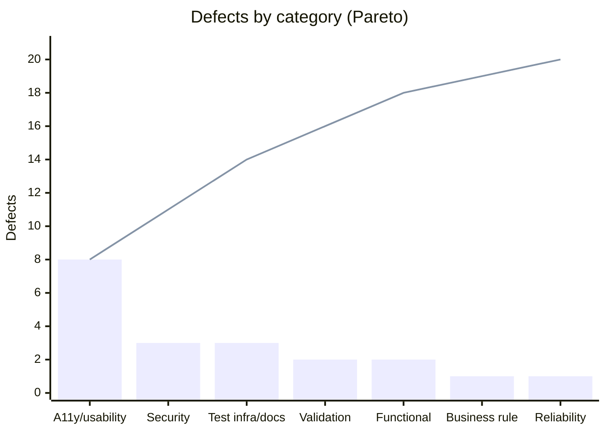

# CARE Encounter Management – Defect Register

**Scope:** Workflow 1 (Create Patient Encounter) and Workflow 2 (Complete Patient Encounter), on the local CARE copy (backend baseline `ddfd840`, frontend baseline `5e02f9a`) with synthetic fixture data.

**Rule for inclusion:** every defect below was reproduced or measured by an executable test, script or tool run. The evidence column says where. Nothing is listed from assumption alone.

**Tracking:** each defect has a GitHub Issue body in [`issues/`](issues/), ready to file in `NovweraAmjad/CARE-Encounter-Management-SQE`. Run [`create-issues.ps1`](create-issues.ps1), which needs the GitHub CLI and `gh auth login`. Then record each issue number in the *GitHub* column.

## Scales

| Severity | Meaning |
|---|---|
| Critical | Data loss, security breach or workflow cannot be completed; no workaround |
| Major | Wrong result, unhandled server error, bypassable business rule or a WCAG A/AA barrier on a workflow step |
| Minor | Degraded experience with a workaround; non-blocking accessibility or usability issue |
| Trivial | Cosmetic |

| Priority | Meaning |
|---|---|
| P1 | Fix before release / before the quality gate can pass |
| P2 | Fix in the current cycle |
| P3 | Fix in the next cycle |
| P4 | Backlog |

**Triage decisions:**
- **Fix now:** fixed in this project.
- **Report upstream:** a product defect in CARE, to be reported with a proposed fix.
- **Defer:** accepted for now, with a reason.
- **Won't fix:** not a defect in the target environment.

## Register

| ID | Title | Category | Severity | Priority | Status | Triage decision | Evidence | GitHub |
|---|---|---|---|---|---|---|---|---|
| DEF-01 | `POST /api/v1/encounter/` returns **HTTP 500** when `external_identifier` is longer than 100 characters | Input validation and error handling | Major | P2 | Open | Report upstream: add `max_length=100` to `EncounterCreateSpec`/`EncounterUpdateSpec.external_identifier` | `API-ENC-014`; live re-run 28 Nov: 101 chars → 500 `DataError`, 100 chars → 200; `testing/evidence/endpoint-weaknesses.md` EW-01 | |
| DEF-02 | `PUT /api/v1/encounter/{id}/` returns **HTTP 500** when `hospitalization` is `null` | Input validation and error handling | Major | P2 | Open | Report upstream: reject `null` (or coerce it to `{}`) in the spec | `API-ENC-024`; live re-run 28 Nov: → 500 `IntegrityError`, record unchanged; EW-02 | |
| DEF-03 | Backend accepts a **non-planned encounter with a future start** (BR-ENC-02 is enforced only by the browser form) | Business-rule enforcement | Major | P1 | Open | Report upstream: add the BR-ENC-02 check to the server-side create validation | Live API check 28 Nov: `status=in_progress`, `period.start` = tomorrow → **200**, stored (then cancelled). The UI blocks the same input (`UC1` main test). | |
| DEF-04 | Create Encounter: time input has no accessible name, and the BR-ENC-02 error isn't linked to the field | Accessibility | Major | P2 | **Fixed** (local copy) | Fix now: one-component patch | axe `label` (critical) + Lighthouse; `testing/accessibility/{before,after}/error-association.json`; patch `testing/accessibility/after/care_fe-create-encounter-fix.patch` | |
| DEF-05 | Date-picker calendar icon is an unnamed `role="img"` | Accessibility | Minor | P4 | Open | Defer: in the shared `src/components/ui` primitive, which `care_fe/AGENTS.md` says not to edit directly | axe `svg-img-alt` + Lighthouse snapshot | |
| DEF-06 | Encounter screen has an empty `span[role=button]` sheet trigger with no name | Accessibility | Major | P3 | Open | Report upstream | axe + Lighthouse `aria-command-name` (`testing/accessibility/after/axe-complete.md`) | |
| DEF-07 | Quick-action names don't contain their visible text ("Symptoms" vs "Add Symptom", and 7 others) | Accessibility | Minor | P4 | Open | Report upstream | axe + Lighthouse `label-content-name-mismatch` | |
| DEF-08 | Encounter-status dot uses `aria-label` on a plain `div`, so screen readers drop the status | Accessibility | Minor | P4 | Open | Report upstream | Lighthouse `aria-prohibited-attr` (Patient Home) | |
| DEF-09 | Tab moves focus outside the Create Encounter dialog after Submit | Accessibility | Minor | P3 | Open | Report upstream | Playwright focus log attachment `keyboard-focus-order.json` | |
| DEF-10 | Missing encounter type shows only "Required" | Usability | Minor | P4 | Open | Report upstream | `UC1-EXC-1` | |
| DEF-11 | Hidden `sr-only` duplicate "Mark as Completed" button (tabIndex −1) | Accessibility | Minor | P4 | Open | Report upstream | `EncounterShow.tsx:262-268`; Playwright found 2 buttons | |
| DEF-12 | Encounter screen requests `/account/default_account/` and gets **400** on every load | Functional / integration | Minor | P3 | Open | Report upstream | Lighthouse `errors-in-console` (before and after runs) | |
| DEF-13 | Access and refresh JWTs stored in `localStorage`, and the production CSP is only `Report-Only` | Security | Major | P2 | Open | Report upstream | `testing/security/evidence/session-controls.json`; `care_fe/nginx/nginx.conf:14` (Section 4 F-01/F-02) | |
| DEF-14 | Backend dependencies have published advisories: Django 6.0, DRF 3.16.1, PyJWT 2.12.0, authlib, Pillow, urllib3, cryptography | Security / dependencies | Major | P1 | Open | Report upstream: upgrade (needs team approval) | pip-audit: 119 unique advisories (7 Critical, 54 High); `testing/security/dependency-audit/` | |
| DEF-15 | Local settings allow any CORS origin and any host | Security (configuration) | Minor | P4 | Won't fix | Local development settings only; `deployment.py` uses allow-lists | ZAP 10098; `config/settings/local.py:12` | |
| DEF-16 | Mutation campaign never produced a mutmut score (locally or in CI), so the mutation gate could never pass | Test infrastructure | Major | P1 | **Fixed** | Fix now: see RCA-3 | `testing/mutation/results/mutmut-standard-run.json` (before); new results (after) | |
| DEF-17 | Section 3 "complete" E2E test clicked a hidden 2×2 px shortcut button through JavaScript | Test infrastructure | Minor | P2 | **Fixed** | Fix now: the test uses the visible Actions-panel button | `testing/e2e/specs/encounter-e2e.spec.ts` | |
| DEF-18 | `testing/README.md` backend command used `PYTHONPATH=/tmp/care_testing:/app` (`ModuleNotFoundError: care_testing`) | Documentation | Minor | P3 | **Fixed** | Fix now | Reproduced 28 Nov; README now matches CI (`/tmp:/app`) | |
| DEF-19 | Encounter list `live=true` returns only **completed/cancelled** encounters, so the frontend "Live" view shows ended encounters | Functional | Major | P2 | Open | Report upstream: invert `LiveFilter`. Upstream `test_filters_by_live_as_true` asserts the inverted behaviour. | Live API check 28 Nov: `live=true` → only completed/cancelled; `EncounterList.tsx:129-130` sends `live=true` for "live". 13 surviving mutants (mutation analysis §3.2) | |
| DEF-20 | 5 unhandled ("floating") promises from `queryClient.invalidateQueries` in the create and complete flows | Reliability | Major | P2 | **Fixed** (through a pull request) | Fix now: `void` on fire-and-forget invalidations (`testing/sonar/care_fe-floating-promises-fix.patch`) | SonarQube `typescript:S9383` ×5; gate ERROR → OK (`testing/sonar/results-before-fix/` vs `results-after-fix/`) | |

**Totals:** 20 defects. 17 are in the product (CARE) and 3 in test infrastructure or documentation.
- Open: 14
- Fixed: 5 (DEF-04, DEF-16, DEF-17, DEF-18, DEF-20)
- Won't fix: 1 (DEF-15)
- Reopened: 0

## Pareto by category

| Rank | Category | Defects | % | Cumulative % |
|---:|---|---:|---:|---:|
| 1 | Accessibility and usability (DEF-04–11) | 8 | 40.0 | 40.0 |
| 2 | Security and dependencies (DEF-13–15) | 3 | 15.0 | 55.0 |
| 3 | Test infrastructure and documentation (DEF-16–18) | 3 | 15.0 | 70.0 |
| 4 | Input validation and error handling (DEF-01–02) | 2 | 10.0 | 80.0 |
| 5 | Functional / integration (DEF-12, DEF-19) | 2 | 10.0 | 90.0 |
| 6 | Business-rule enforcement (DEF-03) | 1 | 5.0 | 95.0 |
| 7 | Reliability (DEF-20) | 1 | 5.0 | 100.0 |

**Reading the Pareto:**
- Four categories account for 80% of defects.
- Accessibility dominates by count because Lighthouse and axe scan every element.
- By severity, the **Major, P1/P2 server-side** defects matter more: DEF-03, DEF-01, DEF-02, DEF-19 and DEF-14. That's why root-cause analysis targets them ([rca.md](rca.md)), not the most numerous category.

## Defect density (GQM input)

- **Measured size:** 2,096 non-blank LOC across the in-scope modules:
  - backend: `emr/api/viewsets/encounter.py` 420, `emr/resources/encounter/spec.py` 176, `emr/resources/encounter/constants.py` 73, `security/authorization/encounter.py` 175
  - frontend: `CreateEncounterForm.tsx` 498, `useEncounterProgressController.ts` 164, `MarkEncounterAsCompletedDialog.tsx` 74, `summary-panel-actions.tab.tsx` 161, `EncounterShow.tsx` 355
- **Product defects located in those modules:** DEF-01, 02, 03, 04, 09, 10, 11, 19, 20 = 9.
- **Defect density = 9 / 2.096 KLOC = 4.3 defects/KLOC.**

The other product defects live in shared components, configuration or dependencies outside the measured modules, so they aren't counted against this size.

**Reopen rate:** 0 reopened ÷ 6 closed (5 fixed + 1 won't fix) = **0%**.
