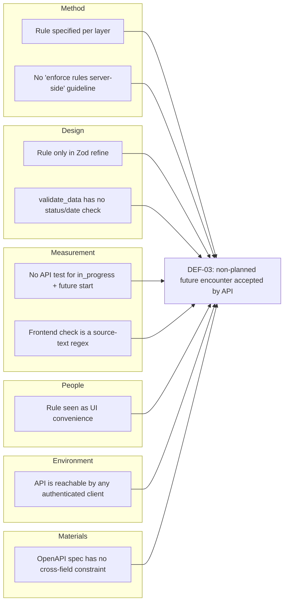
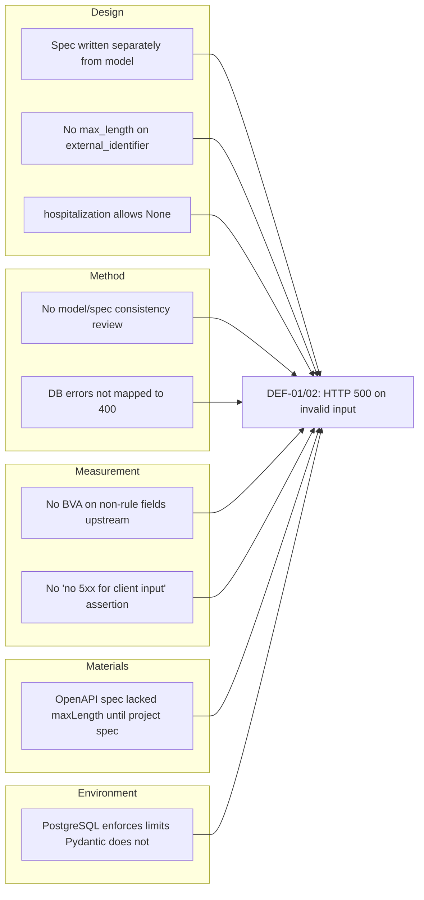
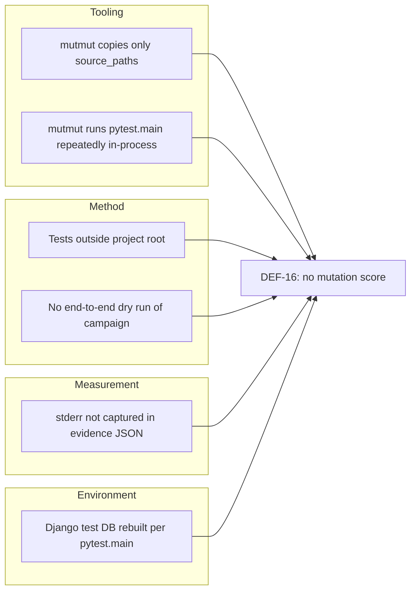

# Root Cause Analysis – Major Defects

Each "why" is backed by a source file, configuration or test result checked on 28 Nov 2026. Where a step is an inference rather than an observed fact, it says so.

---

## RCA-1 – DEF-03: the backend accepts a non-planned encounter with a future start (BR-ENC-02 bypass)

**Problem statement.** `POST /api/v1/encounter/` with `status: "in_progress"` and `period.start` = tomorrow returned **200**, and the record was stored. The browser form blocks the same input with "Future date is only allowed for planned encounters".

### 5 Whys

| # | Why? | Answer | Evidence |
|---|---|---|---|
| 1 | Why was the invalid encounter stored? | The server-side create path has no check combining `status` and `period.start`. | `EncounterViewSet.validate_data` checks only the active count, patient existence and facility existence (`care/emr/api/viewsets/encounter.py:134-152`) |
| 2 | Why is there no server check? | BR-ENC-02 is implemented only as a Zod `.refine()` in the React form. | `care_fe/src/components/Encounter/CreateEncounterForm.tsx:134-146` |
| 3 | Why was it implemented only in the form? | The rule was treated as UI input help (it also greys out future days in the date picker), not as a data-integrity rule. | Same file: the `DatePicker` `disabled` predicate uses the same condition. *Inference from code structure.* |
| 4 | Why didn't anything catch the gap? | No test sends a non-planned future start straight to the API. Upstream tests cover the active limit and the missing patient/facility only. The project's frontend check was a source-text match. | `care/care/emr/tests/test_encounter_api.py`; `testing/frontend/test_encounter_frontend_rules.ts` (BR-ENC-02 = regex on source) |
| 5 | Why does the test basis have no API case for a UI rule? | Rules are specified per layer ("frontend rule"), with no requirement that every business rule is enforced and tested at the API boundary. | `docs/business-rules.md` BR-ENC-02 note: "The inspected backend create spec does not show the same future-date validation" |

**Root cause:** a business rule was allocated to a single layer (the client), and the test strategy had no "every rule is verified at the API" criterion.

### Fishbone (Ishikawa)

### Corrective actions (fix this defect)

1. Add a server-side check in `validate_data` (or `EncounterCreateSpec`): if `status != planned` and `period.start > now`, raise `ValidationError`.
2. Add API tests: in_progress + future → 400, planned + future → 200, in_progress + now → 200 (decision table from BR-ENC-02).

### Preventive actions (stop the class of defect)

1. Test-plan rule: **every business rule needs at least one API-level test**, even if it is also checked in the UI.
2. Replace source-text "contract" checks with behavioural tests: the Playwright `UC1` main and alternative flows now exercise BR-ENC-02 in the browser.
3. Add cross-field constraints to the OpenAPI spec so the generator produces the invalid combination automatically.

---

## RCA-2 – DEF-01 and DEF-02: invalid input causes HTTP 500 instead of 400

**Problem statement.**
- `external_identifier` of 101 characters → **500** (`django.db.utils.DataError: value too long for type character varying(100)`).
- `hospitalization: null` → **500** (`IntegrityError` on the NOT NULL column).

The same root cause produces both.

### 5 Whys

| # | Why? | Answer | Evidence |
|---|---|---|---|
| 1 | Why did the client get 500? | The database rejected the write, and the database exception wasn't converted into a 400 validation error. | Response pages show `DataError` / `IntegrityError` |
| 2 | Why did invalid data reach the database? | The API spec accepted it: `external_identifier: str \| None` has no length limit, and `hospitalization: HospitalizationSpec \| None` allows `None`. | `care/emr/resources/encounter/spec.py:65-67` |
| 3 | Why does the spec disagree with the model? | The Pydantic specs are written separately from the Django model and aren't derived from it. The model says `CharField(max_length=100)` and `JSONField(default=dict)` (NOT NULL). | `care/emr/models/encounter.py:18-20` |
| 4 | Why wasn't the drift detected? | No boundary tests on these fields: upstream tests use valid values only. | Project API tests `API-ENC-014` and `API-ENC-024` were the first to try 101 characters and `null` |
| 5 | Why were there no boundary tests? | The test basis covered business-rule fields first. Non-rule input fields had no EP/BVA requirement until the generator was built from the OpenAPI spec. | `testing/evidence/api-integration-gap-audit.md` (these inputs were listed as "Not executed") |

**Root cause:** model and API-spec constraints are maintained by hand in two places with no consistency check. Boundary testing of non-rule fields wasn't part of the original test design.

### Fishbone (Ishikawa)

### Corrective actions

1. `external_identifier: str | None = Field(default=None, max_length=100)` in the create and update specs.
2. `hospitalization: HospitalizationSpec = HospitalizationSpec()`: no `None`. Alternatively, coerce `None` to `{}` before saving.
3. Keep `API-ENC-014` and `API-ENC-024`, and change their expected result to 400 once fixed.

### Preventive actions

1. A unit test that compares each Pydantic field's `max_length`/nullability with the Django model field, so drift fails CI.
2. A generic API assertion: **no 5xx response for any generated invalid input**. The generator already produces EP/BVA values for every OpenAPI field.
3. Map `DataError`/`IntegrityError` to a 400 response in the DRF exception handler as a safety net.

---

## RCA-3 – DEF-16: the mutation gate never produced a score

**Problem statement.** Every recorded mutmut run (local and CI) ended with `failed to collect stats. runner returned 1`. The score was `null`, and the CI mutation step always failed.

### 5 Whys (each step reproduced on 28 Nov)

| # | Why? | Answer |
|---|---|---|
| 1 | Why no score? | mutmut's stats phase failed before any mutant ran. |
| 2 | Why did stats fail? | pytest, run by mutmut from its `mutants/` copy, couldn't import Django's `config` package. mutmut copies only `source_paths`. Fix: `also_copy`. |
| 3 | After that, why did per-mutant runs fail? | The tests were outside the project root, so mutmut's test IDs ("file or directory not found") couldn't be re-selected. Fix: tests inside the project copy, relative selection. |
| 4 | After that, why did the clean run fail? | mutmut calls `pytest.main()` several times in one process. The conftest rebuilt the test database each time, and on the second rebuild API-created encounters failed a deferred FK check. Reproduced with a two-call script. Fix: create the test DB once per process. |
| 5 | Why did nobody see these errors? | The campaign recorded only mutmut's summary line; the pytest error (stderr) was empty in the saved JSON. |

**Root cause:** the mutation harness was never run end-to-end with its errors visible, and Django's test-database lifecycle didn't fit mutmut's in-process runner.

### Fishbone

**Corrective actions (done):**
- `testing/mutation/campaign.py` now uses `also_copy`, places tests inside the project copy, selects them by relative path, and gives mutmut a clean environment.
- `testing/conftest.py` creates the test database once per process and clears CARE's in-process and Django caches around each test.

**Preventive actions:**
- Keep the pytest error output in the evidence.
- Run the campaign locally before every change to the workflow.
- Make the CI mutation step fail with the captured error text.
