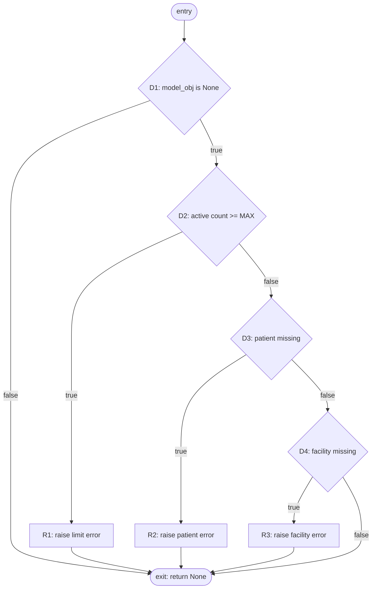

# SonarQube Static Analysis – CARE Encounter Workflows

**Server.** SonarQube 26.11.0.134175 (Community Build), a fresh instance created by `testing/sonar/sonar-gate.sh`. It's the same script CI uses, against a SonarQube service container.

**Scanner.** `@sonar/scan` 4.4.0.

**Date.** 28 Nov 2026.

**Scope** (`sonar-project.properties`):
- **Sources:** the system under test for the two workflows.
  - Backend: `emr/api/viewsets/encounter.py`, `emr/resources/encounter/spec.py`, `emr/resources/encounter/constants.py`, `security/authorization/encounter.py`
  - Frontend: `CreateEncounterForm.tsx`, `useEncounterProgressController.ts`, `MarkEncounterAsCompletedDialog.tsx`, `summary-panel-actions.tab.tsx`, `EncounterShow.tsx`
- **Tests:** `testing/` is analysed as test code.
- **Coverage:** backend coverage comes from coverage.py (67 tests). The frontend files are excluded from the coverage metric only: they're verified by Playwright, which produces no line coverage.

**Evidence** (all in `testing/sonar/`):
- `results-after-fix/`: measures, per-file measures, issues, gate status
- `results-before-fix/`: same coverage, without the DEF-20 fix
- `cyclomatic-check/`: the single-function check

## 1. Metrics (after the DEF-20 fix)

| Metric | Value | What it shows |
|---|---|---|
| Lines of code (ncloc) | 2,028 | Size of the scoped code without blanks or comments; the base for debt ratio and density |
| Functions | 90 | |
| **Cyclomatic complexity** | 224 (sum) | Number of independent paths, i.e. the minimum number of test cases for branch coverage. Highest: viewset 57, `CreateEncounterForm.tsx` 49, authorization 28 |
| **Cognitive complexity** | 119 | How hard the code is to *read* (nesting is penalised more). Viewset 51: `get_queryset`'s nested access paths are the hardest part to follow |
| **Duplication** | 0.0% (0 blocks) | No copy-paste blocks; changes to a rule don't need to be repeated elsewhere |
| **Code smells** | 2 (Minor) | Both are `typescript:S7773` "Prefer `Number.isNaN`" in the time-input handler (`CreateEncounterForm.tsx:311`). Global `isNaN` coerces its argument; low impact here because the value is already a number |
| **Bugs** | **0** (5 before the fix) | Reliability issues likely to cause wrong behaviour (§2) |
| **Vulnerabilities** | 0 | No security rule violated in the scoped code |
| Security hotspots | 0 | Nothing needing manual security review |
| **Coverage** | **76.8%** overall (line 80.3%, branch 61.4%) | Combined line+branch coverage of the 4 backend files. Per file: spec 100%, constants 100%, viewset 67.8%, authorization 59.0%. The business-rule functions are at 100% (coverage gate) |
| **Technical debt** | 4 min (debt ratio 0.0%) | Estimated time to fix all code smells |
| **Ratings** | Reliability **A**, Security **A**, Maintainability **A**, Security review **A** | A = no bugs / no vulnerabilities / debt ratio ≤ 5% / all hotspots reviewed |

**Reading the numbers together:**
- The code is **small and clean but branch-heavy**: complexity 224 in 2,028 lines.
- Branch coverage (61.4%) is the weakest figure. The uncovered branches are in viewset actions outside both workflows: organization management, facility identifiers, care-team actions. They're also in authorization helpers for medication, service requests and reports.
- Mutation testing (`testing/evidence/mutation-analysis.md`) complements this. Coverage shows that code was *run*; the 92.8% mutation score shows the assertions would *notice* changes.

## 2. Bugs found: before and after the fix (DEF-20)

| | Before fix | After fix |
|---|---|---|
| Bugs | **5** × `typescript:S9383` (Major): "Promises must be awaited…" | **0** |
| Reliability rating | **C** | **A** |
| Quality gate | **ERROR** (`reliability_rating` 3 > 1) | **OK** |

**Locations:**
- `CreateEncounterForm.tsx:197`: `queryClient.invalidateQueries(...)` after creating an encounter
- `useEncounterProgressController.ts:34, 41, 44, 45`: after completing an encounter or appointment

A rejected invalidation promise is unhandled.

**Fix** (`testing/sonar/care_fe-floating-promises-fix.patch`): mark these deliberate fire-and-forget calls with `void`. TanStack Query handles refetch failures itself. The fix is delivered through a pull request: the CI gate fails before it and passes after (see the completion report).

## 3. Quality gate (`testing/sonar/quality-gate.json`)

The default "Sonar way" gate checks only **new code**. On a fresh server's first analysis there is no new code, so it can't fail. This project's gate therefore puts its conditions on **overall** code:

| Condition | Threshold | Justification |
|---|---|---|
| Reliability rating | A | Any bug in the workflow code blocks the merge (5 bugs were found and fixed) |
| Security rating | A | The workflows handle patient data |
| Maintainability rating | A | Debt ratio ≤ 5%; currently 0.0% |
| Duplicated lines | ≤ 3% | Currently 0% |
| Coverage | ≥ 75% | Measured 76.8%. A **ratchet** against losing tests. Not 100%, because the remaining uncovered code is upstream code outside both workflows. The business-rule functions are separately held at **100%** by `testing/mutation/coverage_quality_gate.py` |

SonarQube also adds its standard new-code conditions (`new_violations = 0`, new duplication ≤ 3%) to a newly created gate. They're kept, which makes the gate stricter.

## 4. Cyclomatic complexity of `validate_data` (BR-ENC-01): by hand vs SonarQube

```python
def validate_data(self, instance, model_obj=None):
    if model_obj is None:                                   # D1
        if (...).count() >= settings.MAX_ACTIVE_...:        # D2
            raise ValidationError(error)                    # R1
        if not Patient.objects.filter(...).exists():        # D3
            raise ValidationError("Patient does not exist") # R2
        if not Facility.objects.filter(...).exists():       # D4
            raise ValidationError("Facility does not exist")# R3
```

**Control-flow graph:**



**Counting (the entry node is merged into D1):**
- **Nodes (N = 8):** D1, D2, D3, D4, R1, R2, R3, exit.
- **Edges (E = 11):** D1→exit, D1→D2, D2→R1, D2→D3, D3→R2, D3→D4, D4→R3, D4→exit, R1→exit, R2→exit, R3→exit.

| Method | Calculation | Result |
|---|---|---|
| V(G) = E − N + 2P | 11 − 8 + 2·1 | **5** |
| V(G) = decisions + 1 | 4 binary decisions (D1–D4) + 1 | **5** |
| V(G) = regions of the planar graph | 4 bounded + 1 outer | **5** |
| **SonarQube** `complexity` | Only this function's source scanned (`testing/sonar/cyclomatic-check/`) | **5** ✅ |

The hand calculation matches SonarQube. SonarQube's Python complexity counts +1 for the function plus +1 for each `if`, which here is 1 + 4 = 5.

**Cognitive complexity** is 7, by hand and in SonarQube: +1 for `if model_obj is None`, then +2 each for the three `if`s nested one level inside it. SonarQube reports 7, which matches.

**Implication for testing:** five independent paths need at least five test cases for full path/branch coverage:
1. update (D1 false)
2. limit reached
3. patient missing
4. facility missing
5. all checks pass

`UNIT-ENC-001`–`006` and `API-ENC-001/002/033` cover all five. The MCC/MC/DC tables in `testing/coverage/mcc-mcdc.md` go further, to condition level.
